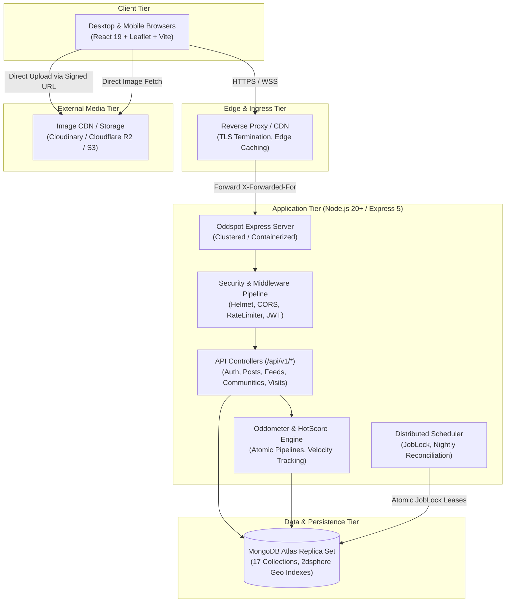
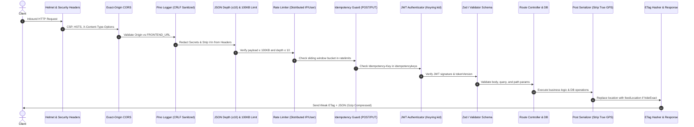
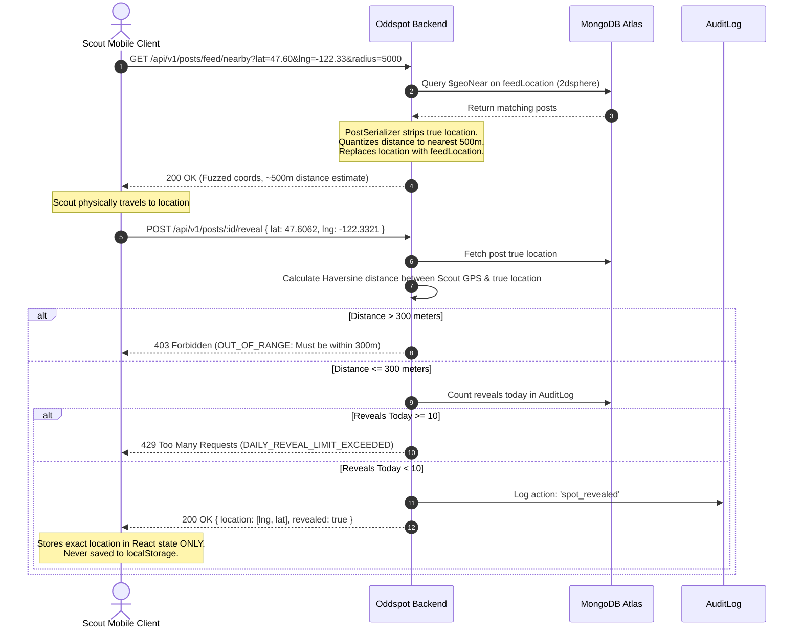
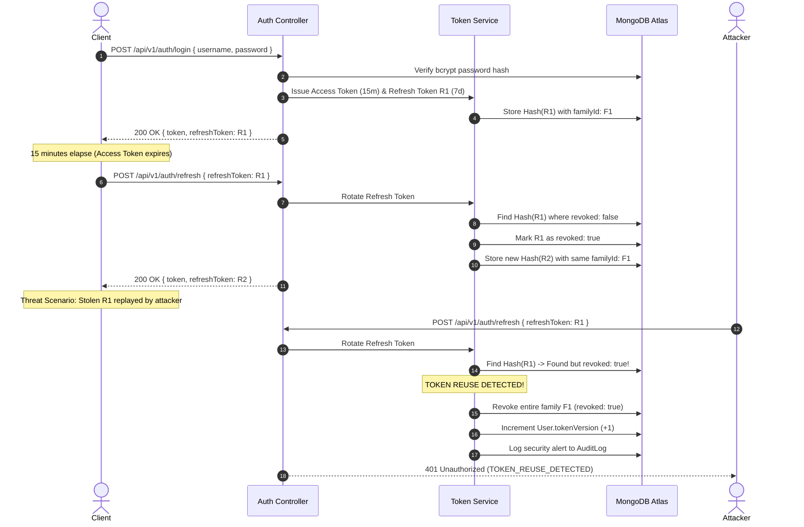

# Oddspot System Architecture Specification

This document provides the authoritative system architecture, component topology, middleware pipeline lifecycle, data flow sequence diagrams, and Oddometer mechanics for the Oddspot platform.

---

## 1. System Overview & Philosophy

Oddspot is a hyper-local, community-driven platform for discovering, documenting, and physically visiting real-world curiosities, obscure roadside artifacts, and urban anomalies.

### Core Architectural Tenets
1. **Zero-Trust Location Privacy**: True physical coordinates of sensitive landmarks are never exposed to anonymous or remote users. Geofenced reveals require physical presence ($\le 300\text{m}$) and are subject to strict daily velocity caps.
2. **Deterministic Anti-Trilateration**: Geometric trilateration is prevented by design through single-point HMAC polar coordinate fuzzing and quantized distance responses.
3. **Denormalized Real-Time Performance**: Feed queries resolve in sub-millisecond database lookups using compound indexes and denormalized counters, backed by nightly consistency reconciliation.
4. **Resilient Token Lifecycle**: Cryptographically secure, single-use rotating refresh tokens with automated reuse detection and family-wide revocation guard against session hijacking.
5. **Zero Binary Storage**: The database and application servers process zero binary uploads; all media is handled through pre-signed CDN uploads with EXIF stripping and strict SSRF allowlisting.

---

## 2. High-Level System Topology



---

## 3. Component Breakdown

### 3.1 Frontend Client (Vite + React 19)
- **Routing**: Client-side hash routing (`HashRouter`) providing seamless static file hosting without requiring server-side fallback rewrite configuration.
- **Geospatial Radar & Map**: Custom Leaflet integration with OpenStreetMap raster tiles, Web Mercator projection, deterministic distance clustering (`frontend/src/utils/mapCluster.js`), and fuzzed-circle bounding overlays (400m dashed radii).
- **Design System & Theme Engine**: CSS custom property design tokens (`frontend/src/styles/tokens.css`) supporting 4 presets (`neon-night`, `paper-zine`, `terminal`, `vaporwave`), live customizer, and automatic WCAG 2.2 contrast ratio computation (<4.5:1 warnings).
- **Session Privacy**: Coordinates unlocked via Reveal-on-Arrival are held strictly in React memory state and never stored in `localStorage` or `sessionStorage`.

### 3.2 Backend API Server (Node.js 20+ / Express 5)
- **Modular Controller Architecture**: Versioned routes mounted at `/api/v1/*` (with backward-compatible `/api/*` aliasing).
- **Input Validation & Sanitization**: Comprehensive input filtering rejecting prototype pollution, script tags, control characters, and ReDoS payloads before reaching handlers.
- **Structured Observability**: Structured Pino logger with automated secret redaction (`authorization`, `password`, `refreshToken`) and CRLF/ANSI log injection neutralization.
- **Prometheus Metrics**: High-resolution metrics exposed at `/metrics`, guarded by constant-time `METRICS_TOKEN` authentication.

### 3.3 Database Tier (MongoDB Atlas Replica Set)
- **Geospatial Indexes**: High-performance `2dsphere` indexes on `location` (true) and `feedLocation` (fuzzed).
- **Compound Feed Indexes**: Cursor-based sorting indexes (`{ 'place.cityKey': 1, hotScore: -1, _id: -1 }`) supporting sub-10ms paginated queries.
- **Native Schema Validators**: MongoDB `collMod` schema validation rules enforcing document structure at the storage layer.
- **Automated TTL Eviction**: Background WiredTiger eviction threads managing transient records.

---

## 4. Inbound Request Middleware Pipeline

Every HTTP request traverses an ordered defense-in-depth pipeline:



---

## 5. Location Privacy & Reveal Sequence



---

## 6. Authentication & Refresh Token Family Sequence



---

## 7. Oddometer Mechanics & Tier Progression

The Oddometer is the dynamic social vitality gauge ranking real-world discoveries.

### 7.1 Dynamic Score Equation

The Oddometer score $S$ is calculated dynamically within an atomic MongoDB update pipeline (`backend/services/meter.js`):

$$S = w_{\text{reaction}} R + w_{\text{visit}} V + w_{\text{comment}} C + w_{\text{like}} L - w_{\text{dislike}} D$$

Default weights:
- $w_{\text{reaction}} = 1$
- $w_{\text{visit}} = 2$ (Physical visits carry double weight)
- $w_{\text{comment}} = 3$ (Discussions signal high curiosity)
- $w_{\text{like}} = 1$
- $w_{\text{dislike}} = 1$

### 7.2 Tier Progression & Ratchet Mechanism

Spots advance through four progressive stages:

```
[Local Whisper]  --->  [Neighborhood Eyebrow-Raiser]  --->  [City Sensation]  --->  [Country-Wide Certified Oddity!]
   (Score < 10)                 (Score ≥ 10)                    (Score ≥ 30)                    (Score ≥ 100)
```

1. **Ratchet Principle**: Once a spot reaches `'country'` tier ($S \ge 100$), its tier is permanently locked to `'country'`. Downvote brigades cannot force a country-wide landmark back down to city or local tiers.
2. **Velocity Freeze**: If 10 or more distinct accounts interact with a spot within a sliding 60-second window, `post.velocityFrozen` trips to `true`. While frozen, the score is held static in feed rankings until moderator verification.

### 7.3 Logarithmic Decay Hot Score

To ensure fresh, active discoveries surface on city and country front pages, the `hotScore` $H$ combines score order with temporal decay:

$$H = \text{sign}(S) \cdot \log_{10}\left(\max(|S|, 1)\right) + \frac{t - t_0}{45,000}$$

Where:
- $t$: Post creation epoch timestamp in seconds.
- $t_0$: Reference baseline epoch ($1,700,000,000$).
- $45,000$: Decay constant (~12.5 hours per unit of magnitude).

---

## 8. Deployment Architecture & Operations

- **Containerization**: Multi-stage Docker build utilizing `node:20-alpine`, producing an ultra-lightweight ($<140\text{MB}$) container with zero build tools in the runtime image.
- **Process Orchestration**: Docker Compose or Kubernetes with memory caps (`512MB`) and CPU quotas (`1.0`).
- **Graceful Shutdown**: The server handles `SIGTERM` and `SIGINT` signals, pausing inbound requests, draining active HTTP connections within a 15-second grace period, and closing MongoDB connection pools cleanly.
- **Health Probes**:
  - `GET /health`: Instant liveness probe for load balancer health checking.
  - `GET /ready`: Readiness probe verifying MongoDB connectivity and replica set state.
